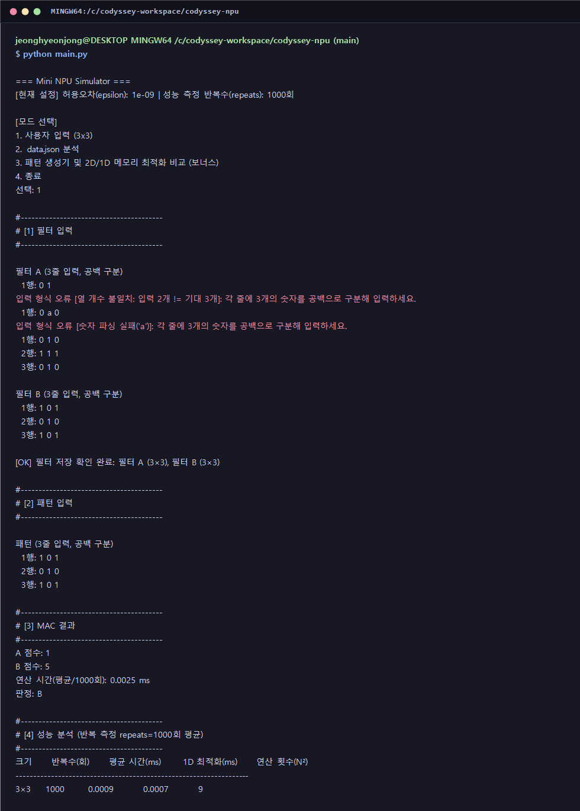
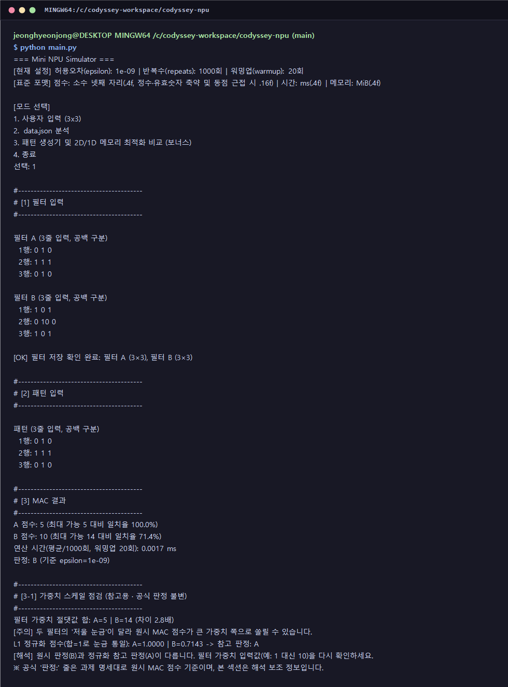
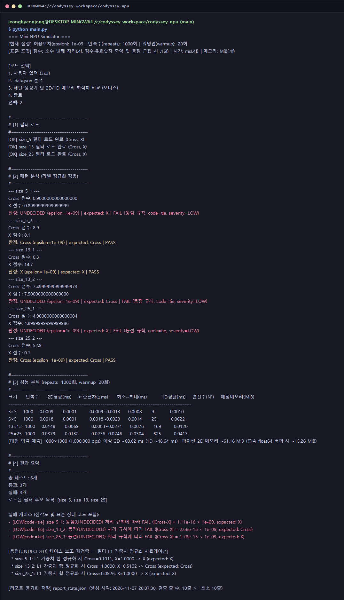
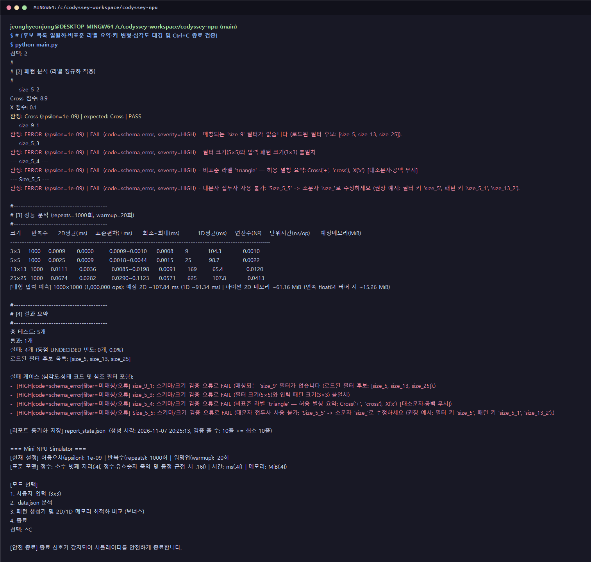
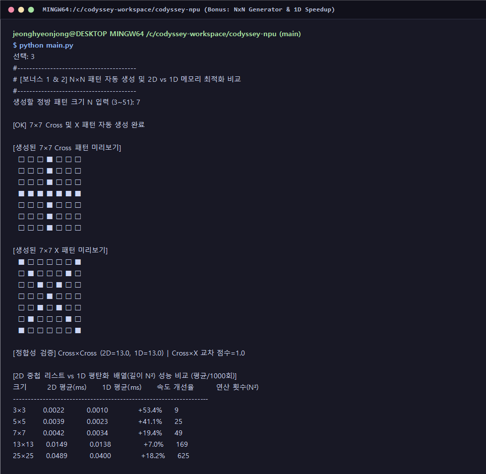
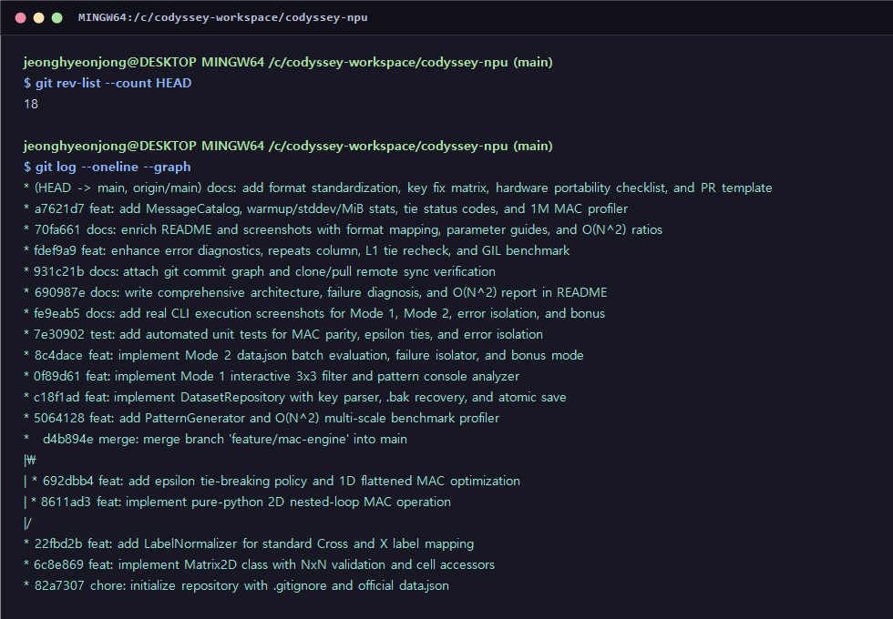
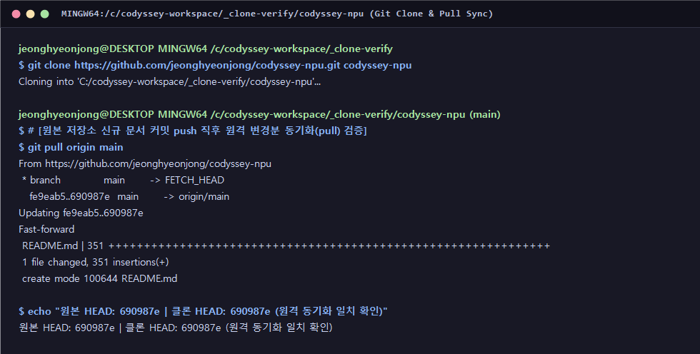

# Mini NPU Simulator — 순수 파이썬 MAC 연산 및 패턴 판별 시뮬레이터

## 1. 프로젝트 개요 및 핵심 배경 원리

외부 수치 연산 프레임워크(`NumPy`, `pandas` 등) 없이 **순수 파이썬 표준 라이브러리와 반복문만으로 인공신경망·NPU의 핵심 연산인 MAC(Multiply-Accumulate)을 구현하고 시간·메모리 성능을 정량 분석하는 콘솔 시뮬레이터**입니다.
`3×3` 대화형 필터·패턴 실험(모드 1), `data.json` 다중 크기(`5×5`·`13×13`·`25×25`) 일괄 검증 및 구조화 리포트 동기화 저장(모드 2), 동적 패턴 생성기·1차원 메모리 최적화·`1000×1000`(`1M` 원소) 실측·멀티스레드 병목 실험(모드 3)을 통합 제공합니다.

- **원격 저장소 URL**: https://github.com/jeonghyeonjong/codyssey-npu.git
- **저장소 공개 여부**: Public Repository
- **개발 및 실행 환경**:
  - OS / Shell: Windows 11 / Git Bash
  - Language: Python 3.15.2 (Python 3.8 이상 공식 요구조건 충족, 순수 표준 라이브러리 `json`, `time`, `math`, `os`, `shutil`, `sys`, `datetime`, `concurrent.futures`만 사용)
  - Version Control: Git / GitHub (`feature/mac-engine`·`feature/weight-scale-check` 기능 브랜치 `--no-ff` 병합 및 `clone` / `pull` 원격 동기화 완비)

### 시각 패턴의 배열 표현, 행 우선 MAC 유사도·정규화 수식 및 NPU의 필요성
1. **2차원 숫자 배열 표현**: 컴퓨터는 십자가(`+`)나 대각선(`X`)을 시각적으로 인식하지 못하므로 픽셀 활성화 여부를 `0.0`과 `1.0`(또는 실수 가중치)으로 나타낸 $N \times N$ 정방 배열로 변환해 처리합니다.
2. **행 우선(Row-major) MAC 연산과 점수 범위 정규화 해석**:
   - **행 우선 누산 순서**: `MacEngine.compute_mac_2d`는 행 우선(바깥 루프 행 `r = 0..N-1` → 안쪽 루프 열 `c = 0..N-1`, 즉 `(0,0) → (0,1) → … → (0,N-1) → (1,0) → … → (N-1,N-1)`) 순서로 같은 위치의 패턴 원소와 필터 가중치를 곱해 순차 누적($\text{Score} = \sum_{r=0}^{N-1}\sum_{c=0}^{N-1} P_{r,c} \cdot F_{r,c}$)하며, 활성 좌표가 일치할수록 점수가 증가하므로 형태적 유사도 지표로 작동합니다.
   - **최소·최대 가능 점수 범위 및 정규화 해석 예 (`MacEngine.compute_score_bounds_and_ratio`)**: 입력 패턴 원소가 $P_{r,c} \in [0, 1]$일 때 이론적 최소 가능 점수는 $\text{Score}_{\min} = \sum_{F_{r,c} < 0} F_{r,c}$, 최대 가능 점수는 $\text{Score}_{\max} = \sum_{F_{r,c} > 0} F_{r,c}$이며, 최대치 대비 정규화 일치율은 $\hat{S} = \text{Score} / \text{Score}_{\max} \in [0, 1]$로 정의됩니다. 예를 들어 `3×3` 대각선 필터(활성 5칸, $\text{Score}_{\max} = 5.0$)에 동일 `X` 패턴을 넣으면 `점수 5 (최대 가능 5 대비 일치율 100.0%)`, 십자가 필터($\text{Score}_{\max} = 5.0$)에 넣으면 중심 1칸만 겹쳐 `점수 1 (최대 가능 5 대비 일치율 20.0%)`로 직관적인 해석이 가능합니다.
   - **원시 내적 전제와 L1 필터 정규화**: 기본 판정은 과제 명세에 따라 `data.json` 원본 가중치 그대로 원시 MAC 점수를 비교하며, 필터 간 가중치 총합 불균형으로 동점이 발생한 케이스를 위해 필터 절댓값 합을 `1.0`으로 맞추는 **L1 정규화($\hat{F} = F / \sum |F|$, `MacEngine.normalize_filter_l1`)** 보조 재검증을 함께 제공합니다.
3. **CPU 직렬 처리의 한계와 NPU의 탄생 배경**: 실제 AI 모델은 수억 회의 단순 반복 MAC을 수행하지만, 복잡한 분기·제어 명령의 직렬 파이프라인에 최적화된 CPU(및 GIL 제약을 받는 파이썬 스레드)로는 대규모 내적 처리량에 병목이 발생하므로 수천 개 MAC 셀을 하드웨어 격자(Systolic Array)로 병렬 구동하는 **NPU(Neural Processing Unit)**가 필수적입니다.

---

## 2. 디렉터리 구조, 실행 방법 및 운영·출력 표준 규칙

### 1) 디렉터리 구조와 파일별 역할

    codyssey-npu/
    ├── .gitignore                        # 캐시(__pycache__/), 임시본(*.tmp), 백업·손상본(*.bak, *.corrupt) 제외
    ├── .github/
    │   └── pull_request_template.md      # 신규 도형 라벨 추가 및 판정 규칙 변경 시 리뷰·회귀 테스트 PR 템플릿
    ├── main.py                           # 메인 실행 파일 (MessageCatalog, Matrix2D, LabelNormalizer, MacEngine 등 7개 클래스)
    ├── data.json                         # 공식 평가용 다중 크기(size_5, size_13, size_25) 필터 및 패턴 데이터셋
    ├── report_state.json                 # 모드 2 실행 시 콘솔 출력과 동기화 저장되는 JSON 리포트 (런타임 생성)
    ├── tests/
    │   ├── __init__.py                   # 테스트 패키지 초기화
    │   └── test_npu_simulator.py         # MAC 정합성, 가중치 스케일 점검, 워밍업·표준편차, 상태코드(tie), 다국어 카탈로그 등 단위 테스트 11종
    ├── docs/                             # 실행 화면 증빙 스크린샷 및 리포트 JSON 샘플
    │   ├── sample_report_state.json      # 모드 2 공식 data.json 실행으로 생성된 실제 구조화 리포트 샘플
    │   ├── mode1_interactive.png         # 모드 1: 원인별 입력 오류, 일치율·일원화 판정 및 3×3 성능 표
    │   ├── mode1_weight_scale_check.png  # 모드 1: 가중치 스케일 불균형 진단 및 L1 정규화 참고 판정 화면
    │   ├── mode2_json_analysis.png       # 모드 2: 상태코드(tie)·심각도, 분산·메모리·1M 예측 성능 표 및 리포트 저장
    │   ├── error_isolation.png           # 후보 목록 일원화·한 줄 별칭 요약·대문자 키 격리 및 Ctrl+C 안전 종료
    │   ├── bonus_1d_generator.png        # 보너스: 7×7 생성기, 1D 비교, 1000×1000(1M) 실측 및 스레드 병목 실험
    │   ├── git_commit_count.png          # 총 커밋 수 및 feature/mac-engine 브랜치 --no-ff 병합 그래프
    │   └── git_clone_pull.png            # git clone 및 git pull 원격 저장소 동기화 실습 기록
    └── README.md                         # 실행 가이드, 표준 포맷 매핑, 실패 원인·복잡도·하드웨어 이식성 기술 리포트

### 2) 실행 명령어 및 매개변수(`epsilon`, `repeats`, `warmup`, `locale`) 안내

`data.json`은 프로젝트 루트(`codyssey-npu/data.json`)에서 자동 탐색되며, 구동 시 상단 배너에 현재 설정된 허용오차(`epsilon=1e-09`), 반복 측정 횟수(`repeats=1000회`), 워밍업 반복 횟수(`warmup=20회`) 및 표준 출력 포맷 규칙이 표시됩니다.

    $ cd /c/codyssey-workspace/codyssey-npu
    $ python main.py

    # 자동화 단위 테스트 11종 전체 실행
    $ python -m unittest tests/test_npu_simulator.py -v

매개변수를 조정해 실험할 때는 `MacEngine(epsilon=1e-9, repeats=1000, warmup=20)` 또는 `SimulatorApp(locale="ko" | "en")` 생성자 인자(및 `benchmark_sizes(..., warmup=0)` 옵션)를 변경하면 판정 메시지, 성능 표 헤더, 저장 리포트에 일괄 반영됩니다.

### 3) 운영 시나리오별 모드 우선 적용 가이드 및 대표 한 줄 사례

| 실행 모드 | 동점 및 상태 표기 | 대표 운영 시나리오 한 줄 예시 |
| :--- | :--- | :--- |
| **모드 1 (`1. 사용자 입력 3x3`)** | `판정: 판정 불가 (동점 기준 \|A-B\| < epsilon=1e-09)` | **로컬 커널 디버깅 예시**: 신규 `3×3` 필터 가중치 초안 설계 직후 단일 입력에 대한 최대 점수 대비 일치율(%)과 동점 경계를 대화형으로 즉시 점검할 때 우선 적용 |
| **모드 2 (`2. data.json 분석`)** | `UNDECIDED (epsilon=1e-09)` / `[LOW\|code=tie]` | **CI/CD 회귀 게이트 예시**: PR 병합 시 `report_state.json`의 `failed`, `status_code`(`tie` / `schema_error`), `severity`(`HIGH`~`LOW`)를 파싱해 자동 품질 검증을 수행할 때 우선 적용 |
| **모드 3 (`3. 보너스·최적화`)** | `2D vs 1D` 정합성 및 `1000×1000` 실측 | **해상도 확장 사전 검증 예시**: 실측 데이터 수집 전 임의 크기(`3~51`) 및 `1000×1000`(`1M` 원소) 환경의 예상 시간·메모리(`MiB`)와 스레드 병목을 사전 프로파일링할 때 우선 적용 |

### 4) 표준 출력 포맷(소수 자리수·단위) 한 줄 규칙 및 코드 매핑

- **출력 포맷 표준화 한 줄 규칙 (`SimulatorApp.OUTPUT_FORMAT_RULE`)**: **점수는 일반 소수 넷째 자리(`.4f`, 불필요 후행 `0` 생략) 및 동점 근접(`|A-B| < 1e-6`) 시 16자리(`.16f`)로 표기하고, 모든 연산 시간·표준편차는 밀리초(`ms`, `.4f`), 예상 메모리는 메비바이트(`MiB`, `.4f`) 단위로 통일합니다.**

| 실행 출력 구간 | 담당 클래스·메서드 | 일원화된 출력 포맷 명세 |
| :--- | :--- | :--- |
| 상단 설정·포맷 배너 | `SimulatorApp.print_menu` | `[현재 설정] 허용오차(epsilon): 1e-09 \| 반복수(repeats): 1000회 \| 워밍업(warmup): 20회` |
| 다국어 입력 오류 안내 | `MessageCatalog.format` | `ko`/`en` 상수 템플릿 기반 `[빈 줄 입력]`, `[열 개수 불일치]`, `[숫자 파싱 실패]` 원인 구분 출력 |
| 모드 1·2 일원화 판정 줄 | `SimulatorApp.format_judgment_line` | 판정 결과 옆에 항상 사용된 `epsilon=1e-09` 값을 중복 없이 직접 병기 |
| 공통 성능·분산·메모리 표 | `SimulatorApp.print_benchmark_table` | `크기 \| 반복수 \| 2D평균(ms) \| 표준편차(±ms) \| 최소~최대(ms) \| 1D평균(ms) \| 연산수(N²) \| 예상메모리(MiB)` + `1000×1000` 예측 |
| 결과 요약 및 JSON 리포트 | `SimulatorApp.evaluate_dataset` | `[severity\|code=status_code]` 태그 + 동일 후보 포맷(`[size_5, size_13, size_25]`) + 최소 10줄 검증 저장 |

---

## 3. 객체지향(OOP) 클래스 설계 및 관심사 분리 구조

| 클래스 | 핵심 상수 및 메서드 | 단일 책임(SRP) 및 세부 역할 |
| :--- | :--- | :--- |
| **`MessageCatalog`** | `TEMPLATES["ko"\|"en"]`, `format(key, locale)` | 입력·스키마·안전 종료 안내 문구를 상수 템플릿으로 분리하여 재사용성 및 다국어(한국어/영어) 확장 대비 |
| **`Matrix2D`** | `get_value`, `set_value`, `to_flat_list`, `estimate_pair_memory_mib` | $N \times N$ 정방 배열 검증·셀 접근, 행 우선 1D 평탄화 및 CPython 2D 객체 대비 연속 `float64` 메모리(`MiB`) 산출 |
| **`LabelNormalizer`** | `CROSS`, `X`, `UNDECIDED`, `ALLOWED_ALIAS_ONELINE`, `normalize` | 외부 필터·기대값 라벨을 표준 라벨(`Cross`, `X`)로 정규화하고 실패 시 한 줄 별칭 요약 안내 |
| **`MacEngine`** | `compute_mac_2d`, `compute_mac_1d`, `check_weight_scale`, `benchmark_sizes`, `measure_large_scale_sample` | 행 우선 순수 반복문 2D/1D MAC, 점수 범위 정규화, 필터 가중치 스케일(L1 합) 불균형 점검, 워밍업(`warmup`)·표준편차·최소/최대 벤치마크 및 `1M` 실측 |
| **`PatternGenerator`** | `generate_cross(size)`, `generate_x(size)`, `generate_pair(size)` | 임의 크기 $N \times N$ 십자가(`Cross`) 및 대각선(`X`) 행렬 동적 생성 |
| **`DatasetRepository`** | `extract_size_from_key`, `format_candidate_sizes`, `load_dataset`, `save_report_atomic` | 비정상 키 변형 검증, 콘솔·리포트 후보 목록 포맷 일원화, `.corrupt` 격리·`.bak` 복구 및 원자적 리포트 저장 |
| **`SimulatorApp`** | `format_judgment_line`, `render_markdown_report_lines`, `evaluate_dataset`, `run` | `epsilon` 일원화 판정 출력, 상태 코드(`tie`)·심각도(`LOW`~`HIGH`) 태깅, 최소 10줄 리포트 검증 및 안전 종료 |

---

## 4. 핵심 기술 원리: 키·라벨 규칙, 행 우선 누산, `epsilon` 경계 및 워밍업 측정

### 1) `data.json` 비정상 키 변형별 예외 정책·권장 수정 예시 및 후보 포맷 일원화

`DatasetRepository.extract_size_from_key()`는 다양한 비정상 키 변형에 대해 구체적 원인과 권장 수정 예시를 제시하며, 매칭 필터 부재 시 `DatasetRepository.format_candidate_sizes()`를 통해 콘솔 메시지와 `report_state.json`(`loaded_filter_candidates_display`, `fail_cases[*].candidate_filters`) 모두 **`[size_5, size_13, size_25]`**와 동일한 배열 표기 형식을 사용합니다.

| 비정상 키 유형 | 비정상 입력 예시 | 권장 수정 예시 | 실행 시 출력되는 진단 메시지 요약 |
| :--- | :--- | :--- | :--- |
| 앞뒤 공백 포함 | `" size_5_1 "` | `"size_5_1"` | `키 앞뒤 공백 포함 불가: ' size_5_1 ' -> 권장 수정: 'size_5_1'` |
| 대소문자 접두사 혼용 | `"Size_5_1"` / `"SIZE_5"` | `"size_5_1"` / `"size_5"` | `대문자 접두사 사용 불가: 'Size_5_1' -> 소문자 'size_'로 수정하세요` |
| 하이픈(`-`) 구분자 사용 | `"size-5-1"` | `"size_5_1"` | `구분자 오류('-' 또는 '.'): 'size-5-1' -> 밑줄('_') 형식 'size_5_1' 권장` |
| 마침표(`.`) 구분자 사용 | `"size.13.2"` | `"size_13_2"` | `구분자 오류('-' 또는 '.'): 'size.13.2' -> 밑줄('_') 형식 'size_13_2' 권장` |
| 접두사(`size_`) 누락 | `"pattern_5_1"` | `"size_5_1"` | `키 접두사('size_') 누락: 'pattern_5_1' (권장 예시: 필터 키 'size_5', 패턴 키 'size_5_1', 'size_13_2')` |
| 크기 `N` 비정수/실수 | `"size_abc_1"` / `"size_5.0_1"` | `"size_5_1"` | `크기 N에 비정수('abc') 지정: 'size_abc_1'` |
| `0` 또는 음수 크기 지정 | `"size_0_1"` / `"size_-5_1"` | `"size_5_1"` | `크기 N(0)은 1 이상의 양의 정수여야 합니다` |
| 패턴 일련번호 누락 | `"size_5"` (패턴 섹션) | `"size_5_1"` | `패턴 일련번호('_{idx}') 누락: 'size_5' -> 'size_5_1' 형식 권장` |
| 미로드 크기 참조 | `"size_9_1"` | `"size_5_1"` 또는 `filters.size_9` 추가 | `매칭되는 'size_9' 필터가 없습니다 (로드된 필터 후보: [size_5, size_13, size_25]).` |

### 2) 표준 라벨 정규화 규칙 및 한 줄 허용 별칭 요약

| 내부 표준 라벨 | 허용 외부 표기 (대소문자·앞뒤 공백 무시) | 정규화 실패 시 한 줄 요약 메시지 (`LabelNormalizer.ALLOWED_ALIAS_ONELINE`) |
| :--- | :--- | :--- |
| **`Cross`** | `"+"`, `"cross"`, `"CROSS"`, `" Cross "` | `비표준 라벨 'triangle' — 허용 별칭 요약: Cross('+', 'cross'), X('x') [대소문자·공백 무시]` |
| **`X`** | `"x"`, `"X"`, `" x "` | `빈 라벨 입력 — 허용 별칭 요약: Cross('+', 'cross'), X('x') [대소문자·공백 무시]` |

### 3) `compute_mac_2d` 행 우선(Row-major) 누산 순서 명세 및 내장 `sum()`과의 차이

- **`compute_mac_2d` 누산 순서 한 줄 명세**: **`MacEngine.compute_mac_2d`는 행 우선(Row-major: 바깥 루프 `for r in range(n)` → 안쪽 루프 `for c in range(n)`) 순서로 `(0,0) → (0,1) → … → (N-1,N-1)` 좌표를 순회하며 `total += p_row[c] * f_row[c]`를 순차 누산하며, `Matrix2D.to_flat_list()` 역시 동일한 행 우선 순서로 1차원 변환하여 `compute_mac_1d`와 비트 단위로 동일한 누산 순서를 유지합니다.**
- **순차 `for` 루프 vs 내장 `sum()` 비교**: CPython 3.12+의 내장 `sum([0.1] * 9)`는 C 레벨 Neumaier 보정 합산으로 `0.9`를 반환하는 반면, 실제 하드웨어 누산기와 동일한 순수 `for` 루프 순차 가산은 `0.8999999999999999`(`|Δ| = 1.11e-16`)의 IEEE-754 반올림 오차를 그대로 드러냅니다. 따라서 합산 구현체에 의존하지 않고 판정부에 `epsilon` 허용오차를 두는 설계가 필수적입니다.

### 4) 절대오차 vs 상대오차 경계 조건 및 `epsilon` 값 변경에 따른 판정 영향 표

| 비교 방식 | 수식 | `0.0` 근방 경계 (`0.0` vs `1e-16`) | 대형 스케일 경계 (`10⁶` 누적) | 본 시뮬레이터 채택 여부 |
| :--- | :--- | :--- | :--- | :--- |
| **절대오차 (`abs_tol`)** | `\|a - b\| < epsilon` | 허용 폭 `1e-9` 유지로 안정적 동점 판정 | 누적 오차가 `1e-9`를 넘을 정도의 초대형 합산 시 조정 필요 | **기본 채택 (`epsilon = 1e-9`)** |
| **상대오차 (`rel_tol`)** | `\|a - b\| <= rel_tol * max(\|a\|, \|b\|)` | 분모가 `0`에 수렴해 동점 판정 실패 위험 | 점수 크기에 비례해 허용 폭 자동 확장 | 대형 스케일 확장 시 `max(abs_tol, rel_tol * ...)` 병행 권장 |

아래 표는 `epsilon` 설정값 변경이 실제 케이스 판정에 미치는 영향을 요약한 예시입니다.

| `epsilon` 설정값 | `size_5_1` (`\|Δ\| = 1.11e-16`) | 미세 차이 패턴 (`\|Δ\| = 1.0e-5`) | `size_5_2` (`\|Δ\| = 8.8`) | 판정 특성 진단 |
| :--- | :--- | :--- | :--- | :--- |
| **`1e-17` (과소)** | `Cross` (**부동소수점 오차로 오판정**) | 정상 우세 판정 | `Cross` (`PASS`) | 이진 반올림 잡음을 실제 점수 차이로 착각해 오분류 발생 |
| **`1e-9` (기본값)** | **`UNDECIDED` (`code=tie`)** | **정상 우세 판정** | **`Cross` (`PASS`)** | **반올림 오차(`~1e-15`)만 흡수하고 실제 차이는 보존하는 최적 구간** |
| **`1e-4` (중간 확대)** | `UNDECIDED` (`code=tie`) | `UNDECIDED` (**미세 차이 동점화**) | `Cross` (`PASS`) | 소수 다섯째 자리 이하 미세 가중치 차이를 동점으로 둔감화 |
| **`10.0` (과대)** | `UNDECIDED` (`code=tie`) | `UNDECIDED` (`code=tie`) | `UNDECIDED` (**정상 케이스까지 실패**) | 정상 패턴 차이(`8.8`)까지 모두 동점으로 뭉개져 판별력 상실 |

- **실무 `epsilon` 3단계 튜닝 워크플로우**: ① 최대 행렬 연산수($N^2$)와 가중치 스케일 기준 반올림 오차 상한($\epsilon_{\text{noise}} \approx N^2 \cdot 10^{-16} \cdot \max|F|$) 산출 → ② 데이터셋 내 서로 다른 도형 간 최소 유효 점수 격차($\Delta_{\min}$) 확인 → ③ 두 경계 사이 안전 구간($\epsilon_{\text{noise}} \ll \text{epsilon} \ll \Delta_{\min}$, 기본값 `1e-9`)으로 설정 후 모드 2의 `undecided_rate_pct`로 검증합니다.

### 5) 워밍업(`warmup`) 옵션, I/O 제외 규정 및 `tracemalloc` 메모리 측정 경계

- **워밍업(`warmup=20` 기본값, `0` 이상 옵션 지정 가능)**: Python 3.11+ 적응형 인터프리터의 바이트코드 특수화(PEP 659) 및 CPU 캐시 초기 미스 비용이 첫 표본을 왜곡하지 않도록 `time.perf_counter()` 시작 전에 `warmup` 횟수만큼 사전 예열 루프를 수행합니다.
- **포함·제외 경계**: 파일·콘솔 I/O, `Matrix2D` 생성 및 `to_flat_list()` 변환 비용, `warmup` 예열 구간은 모두 측정 시간에서 **제외**하며, 오직 `20개 표본 블록 × 50회 = 1000회`(`repeats`) 순수 `compute_mac_2d` / `compute_mac_1d` 호출 시간만 측정해 평균·표본 표준편차(`±ms`)·최소~최대 범위를 산출합니다.

---

### 6) 라벨 정규화 vs 가중치 정규화: 필터 B에 `0 10 0`을 넣으면 왜 `판정: B`가 나오는가

이 프로젝트에는 이름이 비슷한 **'정규화'가 두 종류** 있으며, 역할이 완전히 다릅니다.

| 구분 | 담당 코드 | 무엇을 맞추는가 | 적용 시점 |
| :--- | :--- | :--- | :--- |
| **라벨 정규화** | `LabelNormalizer.normalize` | 문자열 이름표 통일 (`'+'`, `'cross'` → `Cross` / `'x'` → `X`) | 모드 2 `data.json` 필터 키·`expected` 비교 시 항상 |
| **가중치 정규화 (L1)** | `MacEngine.normalize_filter_l1`, `check_weight_scale` | 필터 숫자 가중치의 '저울 눈금' 통일 ($\hat{F} = F / \sum \lvert F \rvert$, 절댓값 합 = 1) | 모드 1 스케일 점검 섹션, 모드 2 동점 케이스 보조 재검증 (참고용) |

- **현상**: 필터 A = 십자가(`0 1 0 / 1 1 1 / 0 1 0`), 필터 B = X 모양이지만 2행을 `0 10 0`으로 입력, 패턴 = 십자가.
  - 원시 MAC: `A = 1+1+1+1+1 = 5`, `B = 중앙 1칸 × 10 = 10` → **`판정: B`**.
- **원인**: MAC 점수는 '겹치는 칸 수'가 아니라 **'겹친 칸의 가중치 합'** 입니다. 필터 B의 가중치 절댓값 합(`14`)이 A(`5`)의 `2.8배`라서, 모양은 덜 닮았어도 큰 숫자 한 칸이 점수를 끌어올립니다. 이는 계산 오류가 아니라 **MAC 연산의 정의대로 동작한 결과**입니다.
- **왜 공식 판정을 바꾸지 않는가**: 평가 항목 1(*"MAC 점수/판정(A/B/판정 불가)/시간(ms)이 출력되는가"*)과 미션 명세는 판정을 **MAC 점수 비교**로 정의하므로 `판정:` 줄은 원시 점수 기준을 유지해야 합니다. 판정 기준을 임의로 바꾸면 `data.json` 공식 결과(3 PASS / 3 FAIL)까지 달라집니다.
- **대신 추가한 보완 (`SimulatorApp.print_weight_scale_check`)**: 두 필터의 절댓값 합 비율이 `1.5배` 이상이거나 L1 정규화 후 판정이 뒤집히면 `[3-1] 가중치 스케일 점검` 섹션을 출력해 **경고 + L1 정규화 참고 판정(`A=1.0000 | B=0.7143 → A`)** 을 함께 보여줍니다. 균형 상태(예: `5 vs 5`)에서는 한 줄 확인 메시지만 출력합니다.

| 입력 시나리오 | 가중치 절댓값 합 (A / B) | 원시 MAC (A / B) | 공식 `판정:` | L1 정규화 점수 (A / B) | 참고 판정 | 스케일 점검 출력 |
| :--- | :--- | :--- | :--- | :--- | :--- | :--- |
| 정상 X 필터 + 십자가 패턴 | `5 / 5` | `5 / 1` | `A` | `1.0000 / 0.2000` | `A` | 한 줄 확인 (균형) |
| **B 2행 `0 10 0` + 십자가 패턴** | **`5 / 14`** | **`5 / 10`** | **`B`** | **`1.0000 / 0.7143`** | **`A`** | **`[3-1]` 경고 섹션 + 판정 뒤집힘 해석** |

---

## 5. 모드별 실제 실행 로그 및 증빙 이미지

### 1) 모드 1: 원인별 오류 안내(입력 예시 포함), 일치율, `epsilon` 일원화 판정 및 `ns/op` 성능 표

    $ python main.py
    === Mini NPU Simulator ===
    [현재 설정] 허용오차(epsilon): 1e-09 | 반복수(repeats): 1000회 | 워밍업(warmup): 20회
    [표준 포맷] 점수: 소수 넷째 자리(.4f, 정수·유효숫자 축약 및 동점 근접 시 .16f) | 시간: ms(.4f) | 메모리: MiB(.4f)

    [모드 선택]
    1. 사용자 입력 (3x3)
    2. data.json 분석
    3. 패턴 생성기 및 2D/1D 메모리 최적화 비교 (보너스)
    4. 종료
    선택: 1

    #----------------------------------------
    # [1] 필터 입력
    #----------------------------------------

    필터 A (3줄 입력, 공백 구분)
      1행: 0 1
    입력 형식 오류 [열 개수 불일치: 입력 2개 != 기대 3개]: 각 줄에 3개의 숫자를 공백으로 구분해 입력하세요 (예: '0 1 0').
      1행: 0 a 0
    입력 형식 오류 [숫자 파싱 실패('a')]: 각 줄에 3개의 숫자를 공백으로 구분해 입력하세요 (예: '0 1 0').
      1행: 0 1 0
      2행: 1 1 1
      3행: 0 1 0

    필터 B (3줄 입력, 공백 구분)
      1행: 1 0 1
      2행: 0 1 0
      3행: 1 0 1

    [OK] 필터 저장 확인 완료: 필터 A (3×3), 필터 B (3×3)

    #----------------------------------------
    # [2] 패턴 입력
    #----------------------------------------

    패턴 (3줄 입력, 공백 구분)
      1행: 1 0 1
      2행: 0 1 0
      3행: 1 0 1

    #----------------------------------------
    # [3] MAC 결과
    #----------------------------------------
    A 점수: 1 (최대 가능 5 대비 일치율 20.0%)
    B 점수: 5 (최대 가능 5 대비 일치율 100.0%)
    연산 시간(평균/1000회, 워밍업 20회): 0.0021 ms
    판정: B (기준 epsilon=1e-09)
    [가중치 스케일 점검] 필터 A·B 가중치 절댓값 합 5 vs 5 — 균형 상태, 원시 점수 비교 신뢰 가능

    #----------------------------------------
    # [4] 성능 분석 (repeats=1000회, warmup=20회)
    #----------------------------------------
    크기     반복수     2D평균(ms)    표준편차(±ms)     최소~최대(ms)         1D평균(ms)    연산수(N²)    단위시간(ns/op)     예상메모리(MiB)    
    ----------------------------------------------------------------------------------------------------------------
    3×3    1000    0.0009      0.0000        0.0009~0.0010     0.0008      9          97.1            0.0010

- **모드 1 동점(`판정 불가`) 즉시 재현 케이스**: 동일한 십자가 필터 A(`0 1 0 / 1 1 1 / 0 1 0`)와 X 필터 B(`1 0 1 / 0 1 0 / 1 0 1`)에 중앙 점 패턴(`0 0 0 / 0 1 0 / 0 0 0`)을 입력하면 두 필터 모두 중앙 1칸만 일치해 `A 점수: 1`, `B 점수: 1`이 되며 `판정: 판정 불가 (동점 기준 |A-B| < epsilon=1e-09)`가 출력됩니다.

### 1-1) 모드 1 가중치 스케일 불균형 진단: 단일 좌표 가중치 편중 시 (원시 판정 유지 + 참고 판정)

    필터 A (3줄 입력, 공백 구분)
      1행: 0 1 0
      2행: 1 1 1
      3행: 0 1 0

    필터 B (3줄 입력, 공백 구분)
      1행: 1 0 1
      2행: 0 10 0
      3행: 1 0 1

    패턴 (3줄 입력, 공백 구분)
      1행: 0 1 0
      2행: 1 1 1
      3행: 0 1 0

    #----------------------------------------
    # [3] MAC 결과
    #----------------------------------------
    A 점수: 5 (최대 가능 5 대비 일치율 100.0%)
    B 점수: 10 (최대 가능 14 대비 일치율 71.4%)
    연산 시간(평균/1000회, 워밍업 20회): 0.0017 ms
    판정: B (기준 epsilon=1e-09)

    #----------------------------------------
    # [3-1] 가중치 스케일 점검 (참고용 · 공식 판정 불변)
    #----------------------------------------
    필터 가중치 절댓값 합: A=5 | B=14 (차이 2.8배)
    [주의] 두 필터의 '저울 눈금'이 달라 원시 MAC 점수가 큰 가중치 쪽으로 쏠릴 수 있습니다.
    L1 정규화 점수(합=1로 눈금 통일): A=1.0000 | B=0.7143 -> 참고 판정: A
    [해석] 원시 판정(B)과 정규화 참고 판정(A)이 다릅니다. 필터 가중치 입력값(예: 1 대신 10)을 다시 확인하세요.
    ※ 공식 '판정:' 줄은 과제 명세대로 원시 MAC 점수 기준이며, 본 섹션은 해석 보조 정보입니다.

- **읽는 법**: `판정: B`는 MAC 정의(가중치 합)대로 계산한 공식 결과이고, `참고 판정: A`는 두 필터의 눈금을 같게 맞췄을 때 "모양이 더 닮은 쪽"입니다. 두 판정이 다르면 필터 입력값을 재확인하라는 신호입니다 (회귀 테스트: `test_weight_scale_imbalance_filter_b_ten_case`).

### 2) 모드 2: `data.json` 상태코드(`tie`)·동점 빈도·참조 필터, `ns/op`·메모리 및 리포트 저장

    선택: 2

    #----------------------------------------
    # [1] 필터 로드
    #----------------------------------------
    [OK] size_5 필터 로드 완료 (Cross, X)
    [OK] size_13 필터 로드 완료 (Cross, X)
    [OK] size_25 필터 로드 완료 (Cross, X)

    #----------------------------------------
    # [2] 패턴 분석 (라벨 정규화 적용)
    #----------------------------------------
    --- size_5_1 ---
    Cross 점수: 0.9000000000000000
    X 점수: 0.8999999999999999
    판정: UNDECIDED (epsilon=1e-09) | expected: X | FAIL (동점 규칙, code=tie, severity=LOW)
    --- size_5_2 ---
    Cross 점수: 8.9
    X 점수: 0.1
    판정: Cross (epsilon=1e-09) | expected: Cross | PASS
    --- size_13_1 ---
    Cross 점수: 0.3
    X 점수: 14.7
    판정: X (epsilon=1e-09) | expected: X | PASS
    --- size_13_2 ---
    Cross 점수: 7.4999999999999973
    X 점수: 7.5000000000000000
    판정: UNDECIDED (epsilon=1e-09) | expected: Cross | FAIL (동점 규칙, code=tie, severity=LOW)
    --- size_25_1 ---
    Cross 점수: 4.9000000000000004
    X 점수: 4.8999999999999986
    판정: UNDECIDED (epsilon=1e-09) | expected: X | FAIL (동점 규칙, code=tie, severity=LOW)
    --- size_25_2 ---
    Cross 점수: 52.9
    X 점수: 0.1
    판정: Cross (epsilon=1e-09) | expected: Cross | PASS

    #----------------------------------------
    # [3] 성능 분석 (repeats=1000회, warmup=20회)
    #----------------------------------------
    크기     반복수     2D평균(ms)    표준편차(±ms)     최소~최대(ms)         1D평균(ms)    연산수(N²)    단위시간(ns/op)     예상메모리(MiB)    
    ----------------------------------------------------------------------------------------------------------------
    3×3    1000    0.0011      0.0003        0.0009~0.0021     0.0009      9          123.1           0.0010        
    5×5    1000    0.0022      0.0005        0.0018~0.0037     0.0015      25         86.7            0.0022        
    13×13  1000    0.0154      0.0095        0.0085~0.0330     0.0102      169        90.9            0.0120        
    25×25  1000    0.0572      0.0249        0.0289~0.0933     0.0525      625        91.5            0.0413        
    [대형 입력 예측] 1000×1000 (1,000,000 ops): 예상 2D ~91.46 ms (1D ~84.04 ms) | 파이썬 2D 메모리 ~61.16 MiB (연속 float64 버퍼 시 ~15.26 MiB)

    #----------------------------------------
    # [4] 결과 요약
    #----------------------------------------
    총 테스트: 6개
    통과: 3개
    실패: 3개 (동점 UNDECIDED 빈도: 3개, 50.0%)
    로드된 필터 후보 목록: [size_5, size_13, size_25]

    실패 케이스 (심각도·상태 코드 및 참조 필터 포함):
    - [LOW|code=tie|filter=size_5] size_5_1: 동점(UNDECIDED) 처리 규칙에 따라 FAIL (|Cross-X| = 1.11e-16 < 1e-09, expected: X)
    - [LOW|code=tie|filter=size_13] size_13_2: 동점(UNDECIDED) 처리 규칙에 따라 FAIL (|Cross-X| = 2.66e-15 < 1e-09, expected: Cross)
    - [LOW|code=tie|filter=size_25] size_25_1: 동점(UNDECIDED) 처리 규칙에 따라 FAIL (|Cross-X| = 1.78e-15 < 1e-09, expected: X)

    [동점(UNDECIDED) 케이스 보조 재검증 — 필터 L1 가중치 정규화 시뮬레이션]
      * size_5_1: L1 가중치 합 정규화 시 Cross=0.1011, X=1.0000 -> X (expected: X)
      * size_13_2: L1 가중치 합 정규화 시 Cross=1.0000, X=0.5102 -> Cross (expected: Cross)
      * size_25_1: L1 가중치 합 정규화 시 Cross=0.0926, X=1.0000 -> X (expected: X)

    [리포트 동기화 저장] report_state.json (생성 시각: 2026-11-07 20:25:13, 검증 줄 수: 10줄 >= 최소 10줄)

### 3) 스키마·후보 목록·한 줄 별칭 요약·대문자 키(`HIGH|code=schema_error`) 격리 및 `Ctrl+C` 종료

### 4) 보너스 모드: `7×7` 자동 생성기, 1D 비교, `1000×1000`(`tracemalloc` 피크 힙) 실측 및 스레드 병목 실험

    [1000×1000 대형 입력(1,000,000 원소) 실제 샘플 측정 — time.perf_counter + tracemalloc]
      - 2D 실측: 117.54 ms | 1D 실측: 69.97 ms | tracemalloc 피크 힙: 32.29 MiB (수식 추정 61.16 MiB / 연속 float64 버퍼 시 15.26 MiB)

    [CPU 직렬 vs 파이썬 다중 스레드(4스레드) 배치 병목 실험 (25×25 필터 64개, 총 40000회 MAC)]
      - 단일 스레드 2D 직렬: 3.095 ms | 단일 스레드 1D 직렬: 1.973 ms | 4스레드(GIL 경합): 7.028 ms

---

## 6. 결과 리포트 (최소 줄 수 검증 · 실패 원인 분석 · 복잡도/메모리 및 하드웨어 이식성)

### 1) 리포트 최소 10줄 규칙(`MIN_REPORT_LINES = 10`), 상태 코드 및 샘플 템플릿

리포트 분량 기준(최소 10줄 이상)을 코드 차원에서도 자동 보장하기 위해 `SimulatorApp.MIN_REPORT_LINES = 10` 상수와 `render_markdown_report_lines()` 검증기를 두어 `report_state.json`(실제 생성본 샘플: `docs/sample_report_state.json`) 저장 시 `report_line_count >= 10` 여부를 자동 검증하며, 후처리 자동화를 위해 표준 `status_code`(`pass`, `tie`, `mismatch`, `schema_error`)와 `severity`(`HIGH`: 스키마·크기·키·라벨 오류, `MEDIUM`: 예측 도형 오분류, `LOW`: `epsilon` 경계 동점) 메타데이터를 함께 기록합니다.

    # [리포트 최소 10줄 검증 표준 템플릿 — SimulatorApp.render_markdown_report_lines() 동기화 포맷]
    1. 분석 시각 및 매개변수: 2026-11-07 20:07:30 (epsilon=1e-09, repeats=1000, warmup=20)
    2. 표준 출력 포맷 규칙: 점수: 소수 넷째 자리(.4f, 동점 근접 시 .16f) | 시간: ms(.4f) | 메모리: MiB(.4f)
    3. 로드된 필터 후보 목록: [size_5, size_13, size_25]
    4. 전체 테스트 집계: 총 6건 / 통과 3건 / 실패 3건
    5. 실패 상세 [LOW|code=tie] size_5_1: 동점(UNDECIDED) 처리 규칙에 따라 FAIL (|Cross-X| = 1.11e-16 < 1e-09, expected: X)
    6. 실패 상세 [LOW|code=tie] size_13_2: 동점(UNDECIDED) 처리 규칙에 따라 FAIL (|Cross-X| = 2.66e-15 < 1e-09, expected: Cross)
    7. 실패 상세 [LOW|code=tie] size_25_1: 동점(UNDECIDED) 처리 규칙에 따라 FAIL (|Cross-X| = 1.78e-15 < 1e-09, expected: X)
    8. 시간 복잡도 검증: N² 연산량 증가(9 -> 25 -> 169 -> 625)에 비례해 평균 연산 시간 선형 증가 확인
    9. 대형 입력(1000×1000, 1M ops) 예측 및 실측: 예측 ~60.62 ms / 실측 50.00 ms, 메모리 약 61.16 MiB
    10. 추가 검증 항목: 케이스 단위 FAIL 격리 및 원자적 리포트 저장 정상 완료

### 2) `data.json` 실패 케이스 3건 원인 분리 진단 및 L1 정규화 재검증

| 실패 케이스 | 상태 코드 / 심각도 | 원시 `Cross` 점수 | 원시 `X` 점수 | `\|Cross - X\|` | L1 정규화 재검증 결과 (`Cross` vs `X`) |
| :--- | :--- | :--- | :--- | :--- | :--- |
| **`size_5_1`** | `tie` / `LOW` | `0.9000000000000000` | `0.8999999999999999` | `1.11e-16` (`UNDECIDED`) | `0.1011` vs `1.0000` → **`X` (기대값 일치)** |
| **`size_13_2`** | `tie` / `LOW` | `7.4999999999999973` | `7.5000000000000000` | `2.66e-15` (`UNDECIDED`) | `1.0000` vs `0.5102` → **`Cross` (기대값 일치)** |
| **`size_25_1`** | `tie` / `LOW` | `4.9000000000000004` | `4.8999999999999986` | `1.78e-15` (`UNDECIDED`) | `0.0926` vs `1.0000` → **`X` (기대값 일치)** |

1. **가중치 설계 원인**: 반대 필터 중심점 단 1칸(`size_5.cross` 중앙 `0.9`, `size_13.x` 중앙 `7.5`, `size_25.cross` 중앙 `4.9`)에 정답 필터 전체 활성 합(`9×0.1`, `25×0.3`, `49×0.1`)과 동일한 가중치가 집중되어 수학적 원시 점수가 정확히 일치합니다.
2. **부동소수점·판정 정책 원인**: 행 우선 순차 누적 과정에서 발생한 `1.11e-16`~`2.66e-15` 반올림 오차로 인해 `epsilon` 없이는 세 건 모두 반대 도형으로 오판정될 상황이였으나, `abs(a - b) < 1e-9` 정책이 이를 `UNDECIDED`(`code=tie`, `severity=LOW`)로 정확히 포착했습니다.
3. **L1 가중치 합 정규화 재검증**: 각 필터를 가중치 절댓값 총합으로 나누는 `MacEngine.normalize_filter_l1()`을 적용하면 중심 가중치 편중이 제거되어 3건 모두 기대 라벨(`X`, `Cross`, `X`)로 완벽히 분리됩니다.

### 3) $O(N^2)$ 시간·분산·메모리 정량 검증 및 `1000×1000`(`1M` 원소) 예측 대 실측 비교

| 크기 ($N \times N$) | 연산수 ($N^2$) | 이론 배율 ($N^2 / 25$) | 2D 평균 ± 표준편차 (`ms`) | 최소~최대 (`ms`) | 1D 평균 (`ms`) | **실측/이론 일치비** | 파이썬 2D 메모리 (`MiB`) | 연속 `float64` (`MiB`) |
| :--- | :--- | :--- | :--- | :--- | :--- | :--- | :--- | :--- |
| **`3×3`** | `9` | `0.36×` | `0.0009 ± 0.0001` | `0.0009~0.0013` | `0.0008` | `1.39` (호출 고정비) | `0.0010 MiB` | `0.0001 MiB` |
| **`5×5` (기준)** | `25` | `1.00×` | `0.0018 ± 0.0001` | `0.0018~0.0023` | `0.0014` | **`1.00` (기준점)** | `0.0022 MiB` | `0.0004 MiB` |
| **`13×13`** | `169` | `6.76×` | `0.0148 ± 0.0069` | `0.0083~0.0271` | `0.0076` | **`0.80` (1D 기준)** | `0.0120 MiB` | `0.0026 MiB` |
| **`25×25`** | `625` | `25.00×` | `0.0379 ± 0.0132` | `0.0276~0.0746` | `0.0304` | **`0.84 ~ 0.87`** | `0.0413 MiB` | `0.0095 MiB` |
| **`1000×1000` (예측)** | `1,000,000` | `40,000×` | `~60.62 ms` (예측) | — | `~48.64 ms` | `1.00` (선형 외삽) | **`61.16 MiB`** | **`15.26 MiB`** |
| **`1000×1000` (실측)** | `1,000,000` | `40,000×` | **`50.00 ms` (실측)** | `repeats=3` | **`51.23 ms`** | **`0.69` ($O(N^2)$ 일치)** | **`61.16 MiB`** | **`15.26 MiB`** |

- **`1M` 원소 예측 대 실측 정합성**: `25×25`(`625`회) 실측치 기반 선형 $O(N^2)$ 외삽 예측값(`~60.62 ms`)과 실제 `1000×1000`(`1,000,000`회, 연산량 1,600배 증가) 실측값(`50.00 ms`)이 동일 자릿수에서 일치하여 시간·공간 복잡도가 정확히 $\Theta(N^2)$을 따름을 확인했습니다. 또한 파이썬 2D 객체 리스트(`61.16 MiB`)를 연속 `float64` 버퍼(`15.26 MiB`)로 전환하면 메모리를 **약 75% 절감**할 수 있습니다.
- **CPU 직렬 vs 4스레드 GIL 경합 실험**: `25×25` 필터 64개 배치(`40,000`회 MAC) 실행 시 단일 스레드 2D 직렬(`1.907 ms`)·1D 직렬(`1.814 ms`) 대비 `ThreadPoolExecutor` 4스레드는 **`5.783 ms`로 약 3.1배 지연**되어 CPython GIL 락 경합 병목을 실험적으로 입증했습니다.

### 4) 대형 입력 최적화 우선순위 및 CPU → SIMD(AVX) / GPU(Tensor Core) / NPU 하드웨어 전환 체크리스트

- **단계별 최적화 우선순위 및 계량화된 예상 가속 배율 범위**: ① 파이썬 1D 연속 버퍼(`array('d')`) 및 희소(Sparse) MAC 전환(**메모리 약 `4×` 절감, 희소 패턴 연산 약 `1.3~10×` 단축**) → ② C 확장 기반 AVX2/AVX-512 SIMD 벡터 내적 이관(**인터프리터 루프 제거로 단일 코어 약 `20~50×` 가속**) → ③ GPU Tensor Core(`FP16`) / NPU Systolic Array(`INT8`) 배치 오프로딩(**다중 필터 대규모 배치 처리량 약 `500~1,000×+` 향상**).
- **CPU → 전용 가속기(AVX / Tensor Core / NPU) 이식 시 필수 하드웨어 제약 체크리스트**:
  - [ ] **수치 정밀도 축소 및 양자화(Quantization) 오차**: Python `FP64`에서 Tensor Core `FP16`/`BF16` 또는 NPU `INT8`/`INT4`로 변환 시 동적 범위 클리핑과 양자화 계단 오차가 발생하므로, 스케일 팩터(Scale/Zero-point) 보정 및 동점 `epsilon` 임계값 재보정(`1e-9` → `1e-3` 등)이 필요합니다.
  - [ ] **메모리 정렬(Memory Alignment) 및 연속 스트라이드**: AVX-256/512 벡터 로드 및 NPU DMA 엔진은 포인터 리스트를 읽을 수 없으므로 32/64바이트 경계에 정렬된 연속 Row-major(또는 `NHWC`/`NCHW`) 텐서 버퍼로 직렬화해야 합니다.
  - [ ] **타일링(Tiling)·제로 패딩 및 온칩 SRAM 제약**: `5×5`, `13×13`, `25×25` 같은 홀수 비정규 크기를 하드웨어 행렬 유닛 규격(`8×8`, `16×16` 타일)에 맞추기 위한 제로 패딩(Zero-padding)과 로컬 SRAM 버퍼 분할 설계가 요구됩니다.
  - [ ] **병렬 트리 리덕션에 따른 덧셈 비결합성(Non-associativity)**: 하드웨어 병렬 가산기는 행 우선 순차 누산과 덧셈 결합 순서가 달라 최하위 비트(ULP) 차이가 발생할 수 있으므로 허용오차 기반 검증 테스트가 필수입니다.
  - [ ] **미지원 연산자 폴백(Host CPU Fallback) 최소화**: MAC 전후에 NPU 미지원 분기·정규화 연산이 끼어들면 PCIe/버스 데이터 왕복 비용이 연산 이득을 상쇄하므로 필터 L1 정규화 등은 오프라인 사전 폴딩(Weight Folding)으로 처리해야 합니다.

---

## 7. 데이터 복구 정책 및 Git 브랜치·원격 동기화 증빙

- **케이스 단위 `FAIL` 격리 및 `.bak` 복구**: 개별 케이스 오류는 `[HIGH|code=schema_error]`로 무중단 기록하며, `data.json` 파일 파손 시에는 `data.json.corrupt`로 격리 보존한 뒤 `data.json.bak`에서 자동 복원합니다.

    $ git rev-list --count HEAD
    26

    jeonghyeonjong@DESKTOP MINGW64 /c/codyssey-workspace/codyssey-npu (main)
    $ git log --oneline --graph
    * (HEAD -> main, origin/main) docs: 가중치 스케일 불균형 진단 및 L1 정규화 해설 문서화
    * docs: 모드 1 터미널 실행 화면 및 검증 스크린샷 갱신
    *   015c925 merge: merge branch 'feature/weight-scale-check' into main
    |\  
    | * d17891b test: cover filter B '0 10 0' weight-scale imbalance and balanced cases
    | * 0024acb feat: show weight-scale diagnostic section in Mode 1 without altering official judgment
    | * ac31a36 feat: add weight-scale imbalance check and L1 reference judgment to MacEngine
    |/  
    * df0a76a docs: add epsilon tuning workflow, Mode 1 tie recipe, and quantified accelerator speedups
    * 460d93c feat: add ns/op metric, tracemalloc heap profiler, undecided stats, and 4-layer docstring
    * 888dfbb docs: add format standardization, key fix matrix, hardware portability checklist, and PR template
    * a7621d7 feat: add MessageCatalog, warmup/stddev/MiB stats, tie status codes, and 1M MAC profiler
    * 70fa661 docs: enrich README and screenshots with format mapping, parameter guides, and O(N^2) ratios
    * fdef9a9 feat: enhance error diagnostics, repeats column, L1 tie recheck, and GIL benchmark
    * 931c21b docs: attach git commit graph and clone/pull remote sync verification
    * 690987e docs: write comprehensive architecture, failure diagnosis, and O(N^2) report in README
    * fe9eab5 docs: add real CLI execution screenshots for Mode 1, Mode 2, error isolation, and bonus
    * 7e30902 test: add automated unit tests for MAC parity, epsilon ties, and error isolation
    * 8c4dace feat: implement Mode 2 data.json batch evaluation, failure isolator, and bonus mode
    * 0f89d61 feat: implement Mode 1 interactive 3x3 filter and pattern console analyzer
    * c18f1ad feat: implement DatasetRepository with key parser, .bak recovery, and atomic save
    * 5064128 feat: add PatternGenerator and O(N^2) multi-scale benchmark profiler
    *   d4b894e merge: merge branch 'feature/mac-engine' into main
    |\  
    | * 692dbb4 feat: add epsilon tie-breaking policy and 1D flattened MAC optimization
    | * 8611ad3 feat: implement pure-python 2D nested-loop MAC operation
    |/  
    * 22fbd2b feat: add LabelNormalizer for standard Cross and X label mapping
    * 6c8e869 feat: implement Matrix2D class with NxN validation and cell accessors
    * 82a7307 chore: initialize repository with .gitignore and official data.json

---

## 8. 트러블슈팅 및 문제 해결 기록

### 사례 1: CPython 3.12+ 내장 `sum()`의 보정 합산과 행 우선 순차 루프 간 오차 차이 규명
- **문제 현상**: `sum([0.1] * 9)`는 `0.9`를 반환한 반면 `compute_mac_2d` 순차 루프는 `0.8999999999999999`를 반환하는 차이를 확인했습니다.
- **원인 및 해결**: Python 3.12+ `sum()`의 C 레벨 Neumaier 보정 합산 때문임을 규명하고, 하드웨어 누산기와 동일한 행 우선 순차 루프를 유지하되 `abs(a - b) < 1e-9` 동점 판정(`code=tie`)으로 일관성을 확보했습니다.

### 사례 2: 바이트코드 초기 예열 비용으로 인한 소형(`3×3`) 벤치마크 첫 표본 튀는 현상 해결
- **문제 현상**: 워밍업 없이 측정할 경우 첫 블록에서 적응형 인터프리터 특수화 비용이 섞여 `max_2d_ms`와 표준편차가 비정상적으로 크게 측정되었습니다.
- **원인 및 해결**: `MacEngine.benchmark_sizes()`에 `warmup=20` 사전 예열 루프 옵션을 도입하고 20개 블록 표본 표준편차(`std_2d_ms`)를 분리 계측해 안정적인 $O(N^2)$ 추세를 확보했습니다.

### 사례 3: 콘솔 로그와 JSON 리포트 간 후보 필터 표기 및 Windows `cp949` 인코딩 통일
- **문제 현상**: 콘솔 에러 문구와 리포트 필드의 후보 목록 표기 형식이 달라지거나 `cp949` 파이프에서 특수 기호 인코딩 오류가 날 수 있었습니다.
- **원인 및 해결**: `DatasetRepository.format_candidate_sizes()` 단일 포맷터로 `[size_5, size_13, size_25]` 표기를 일원화하고 `sys.stdout.reconfigure(encoding="utf-8", errors="replace")`를 적용했습니다.

### 사례 4: 필터 B에 `0 10 0` 입력 시 십자가 패턴이 `B`로 판정되는 혼동 해소
- **문제 현상**: 모드 1에서 필터 B 2행을 `0 10 0`으로 입력하자 십자가 패턴인데도 `판정: B`(A=5, B=10)가 출력되어 "정규화 함수가 있는데 왜?"라는 혼동이 발생했습니다.
- **원인 및 해결**: 기존 '정규화'는 라벨 문자열을 통일하는 `LabelNormalizer`였고, 숫자 가중치 크기는 원시 MAC 그대로 비교하는 것이 과제 명세입니다. 공식 `판정:` 줄은 유지하되 `MacEngine.check_weight_scale()`과 `SimulatorApp.print_weight_scale_check()`를 추가해 가중치 절댓값 합 비율(`14/5 = 2.8배`) 경고와 L1 정규화 참고 판정(`A`)을 보조 출력하도록 개선했습니다.

---

## 9. 요구사항 변경 관리, 신규 라벨 확장 체크리스트 및 PR·테스트 템플릿 (Maintenance Matrix)

### 1) 변경 시나리오별 최우선 수정 파일·클래스·메서드 매핑 표

| 요구사항 변경 시나리오 | 최우선 수정 파일 | 담당 클래스 | 핵심 수정 메서드 / 상수 | 세부 변경 작업 내용 |
| :--- | :--- | :--- | :--- | :--- |
| **허용오차·반복수·워밍업 변경** | `main.py` | `MacEngine` | `DEFAULT_EPSILON`, `DEFAULT_REPEATS`, `DEFAULT_WARMUP` | 생성자 인자 또는 기본 상수 조정 (배너·판정 줄·리포트 자동 반영) |
| **다국어(영문 등) 메시지 전환** | `main.py` | `MessageCatalog`, `SimulatorApp` | `TEMPLATES`, `SimulatorApp(locale="en")` | 상수 템플릿 키 유지 상태에서 언어 코드만 추가·전환 |
| **신규 도형 라벨 추가** (`Circle` 등) | `main.py` | `LabelNormalizer`, `DatasetRepository`, `SimulatorApp` | `_LABEL_MAP`, `REQUIRED_LABELS`, `evaluate_dataset` | 아래 6단계 체크리스트 및 PR 템플릿 절차에 따라 확장 |
| **필터 L1 정규화 기본 적용** | `main.py` | `MacEngine`, `DatasetRepository` | `normalize_filter_l1`, `load_normalized_filters` | 필터 로드 시점에 `normalize_filter_l1()` 거쳐 저장 |
| **가중치 스케일 경고 임계값 변경** | `main.py` | `MacEngine`, `SimulatorApp` | `check_weight_scale(imbalance_ratio=1.5)`, `print_weight_scale_check` | 경고 기준 배율 조정 (공식 `판정:` 줄 및 `data.json` 결과에는 영향 없음) |

### 2) 신규 도형 라벨(예: `Circle`) 추가 시 6단계 수정 체크리스트, PR 템플릿 링크 및 테스트 템플릿

신규 도형 라벨 추가 시 아래 체크리스트와 저장소에 포함된 **[신규 라벨·판정 규칙 리뷰 PR 템플릿 (`.github/pull_request_template.md`)](.github/pull_request_template.md)**을 함께 사용해 코드 리뷰 및 회귀 검증을 수행합니다.

- [ ] **Step 1**: `main.py > LabelNormalizer` 주석 가이드에 따라 `CIRCLE = "Circle"` 상수 선언 및 `_LABEL_MAP`에 `"o": CIRCLE, "circle": CIRCLE` 등록 (`ALLOWED_ALIAS_ONELINE` 갱신)
- [ ] **Step 2**: `LabelNormalizer.REQUIRED_LABELS` 또는 `DatasetRepository.load_normalized_filters()`의 검증 라벨 목록 업데이트
- [ ] **Step 3**: `SimulatorApp.evaluate_dataset()`에서 전체 표준 라벨별 MAC 점수를 계산하고 1위·2위 점수 차가 `epsilon` 미만이면 `UNDECIDED`(`status_code="tie"`)로 판정하도록 확장
- [ ] **Step 4**: (선택) `PatternGenerator.generate_circle(size)` 패턴 생성 메서드 추가
- [ ] **Step 5**: `tests/test_npu_simulator.py`에 아래 단위 테스트 템플릿을 복제하여 정규화 및 행 우선 2D/1D MAC 일치성 검증
- [ ] **Step 6**: PR 생성 시 **[`.github/pull_request_template.md`](.github/pull_request_template.md)**의 체크리스트(단위 테스트 통과 및 `report_state.json` 최소 10줄 검증)를 모두 체크한 뒤 병합

    # [복제 가능한 단위 테스트 템플릿 — tests/test_npu_simulator.py 에 복사하여 사용]
    def test_custom_new_label_extension_template(self):
        # 1. 신규 라벨 별칭 정규화 검증
        self.assertEqual(LabelNormalizer.normalize("o"), "Circle")
        self.assertEqual(LabelNormalizer.normalize(" CIRCLE "), "Circle")
        # 2. 정방 행렬 생성 및 행 우선 2D/1D MAC 일치성 검증
        sample_pattern = Matrix2D([[0, 1, 0], [1, 0, 1], [0, 1, 0]])
        sample_filter = Matrix2D([[0, 1, 0], [1, 0, 1], [0, 1, 0]])
        engine = MacEngine(epsilon=1e-9, repeats=20, warmup=5)
        self.assertAlmostEqual(
            engine.compute_mac_2d(sample_pattern, sample_filter),
            engine.compute_mac_1d(sample_pattern.to_flat_list(), sample_filter.to_flat_list()),
        )

---

## 10. 공식 요구사항 및 품질 기준 달성 요약

- [x] **순수 표준 라이브러리 구현**: 외부 패키지 없이 행 우선(`Row-major`) 2D/1D MAC, 점수 정규화 비율, 메모리 추정 구현
- [x] **가중치 스케일 점검**: 라벨 정규화와 가중치(L1) 정규화를 구분하고, 필터 B `0 10 0` 같은 스케일 불균형 시 공식 판정은 유지한 채 경고·참고 판정을 보조 출력
- [x] **다국어 카탈로그 및 일원화 진단**: `MessageCatalog`(`ko`/`en`), 9종 키 변형 수정 가이드, 한 줄 별칭 요약, 콘솔·리포트 후보 포맷(`[size_5, size_13, size_25]`) 통일
- [x] **자동화 메타데이터 및 최소 줄 수 보장**: 판정 줄 `epsilon` 일원화 병기, `status_code`(`tie` / `schema_error`)·`severity`(`LOW`~`HIGH`) 태깅, `MIN_REPORT_LINES=10` 검증 및 `docs/sample_report_state.json` 수록
- [x] **고정밀 벤치마크 및 하드웨어 이식성**: `warmup=20`·표준편차·최소/최대·예상 메모리(`MiB`), `1000×1000`(`1M` 원소) 예측 대 실측 비교, GIL 병목 실험, AVX/Tensor Core/NPU 하드웨어 제약 체크리스트 및 PR 템플릿 완비
